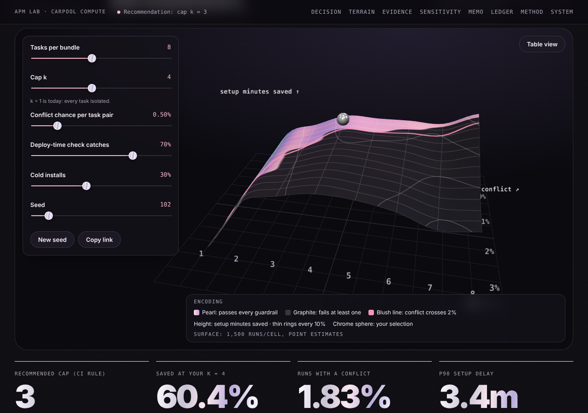

# Carpool Compute · Decision Terrain

[](https://github.com/shriyashekatkar25-byte/carpool-compute/actions/workflows/ci.yml)

**Should every task in a bundle share one serverless environment by default, and how many tasks per environment?** A Monte Carlo decision system with a WebGL decision terrain, SQLite persistence and confidence-bound guardrails.

**[Live demo](https://shriyashekatkar25-byte.github.io/carpool-compute/)** · [APM Lab gallery](https://shriyashekatkar25-byte.github.io/apm-lab/) · [Case study](docs/case-study.md) · [PRD](docs/PRD.md) · [Architecture](docs/architecture.md) · [Evaluation](docs/evaluation.md) · [Design system](docs/design-system.md) · [Creative references](docs/creative-references.md)



## The answer
**Go, cap k = 3.** In 20,000 simulated runs (seed 102), setup minutes fall **51.1%** (95% CI 50.9–51.4%), conflicts hit 1.03% of runs (upper bound 1.18%), and P90 setup delay drops from 6.6 to 5.0 minutes. A point-estimate rule would ship k = 4, but k = 4's conflict upper bound is 2.03%, and across 20 seeds it fails its bound 9 times. The input that matters most is the deploy-time check's catch rate (cap 2 → 7 across 40–90%).

## Inspired by
Databricks released **Shared Serverless for Asset Bundles (Beta)** on October 22, 2026: notebooks and files in a bundle can share serverless compute and an environment defined in the bundle-root `pyproject.toml`. Source: [Databricks platform release notes, October 2026](https://docs.databricks.com/aws/en/release-notes/product/2026/october).

## What's inside
| Layer | Implementation |
|---|---|
| Simulation | `app/engine.js` (Web Worker) and `backend/carpool/engine.py` (NumPy), parity-tested |
| Method | Rejection sampling (Ch4) with inverse-CDF exponential proposals (Ch3), common random numbers, Wilson and batch-means 95% CIs |
| 3D | Three.js r160 + custom GLSL terrain: height = savings, pearl/graphite = guardrail pass/fail, isoline at 2% conflict |
| Data | SQLite in WASM (sql.js) + IndexedDB; the same `migrations/` and `sql/analytics.json` run in the FastAPI backend |
| Analysis | `python -m carpool.cli analyze` → sensitivity, convergence, seed stability, KS validation (`data/*.json`) |
| Quality | 19 pytest + 14 Node + 9 Playwright e2e tests, axe-core 0 violations, GitHub Actions CI |

## Run it
```bash
# static app (no build step)
python3 -m http.server 8000            # open http://localhost:8000

# Python backend
pip install -r requirements.txt
cd backend && python -m pytest -q      # 19 tests
python -m carpool.cli analyze          # regenerates data/*.json
uvicorn carpool.api:app --reload       # POST /simulate, /scenarios · GET /analytics/{id}, /sensitivity

# JS + end-to-end
npm install && npm test                 # 14 tests
python -m playwright install chromium && python -m pytest tests/e2e -q   # 9 tests
```

## How I'd run it on real data
```sql
-- replace the two assumptions that drive the decision (illustrative table names)
SELECT avg(CAST(had_resolver_conflict AS INT)) / avg(n_task_pairs) AS p_conflict_per_pair,
       avg(CAST(caught_at_deploy AS INT))                         AS deploy_check_catch_rate
FROM   main.apm_lab.shared_env_runs
WHERE  run_date >= current_date() - INTERVAL 28 DAYS;
```

## PM skills this demonstrates
Customer problem framing (the default is the real decision) · prototyping (an interactive model, not a slide) · SQL/Python (two engines, shared schema, analytics) · data-driven decisions (confidence-bound guardrails, sensitivity) · clear writing (PRD, memo, case study).

## Credits
Visual references were studied, not reused; the full list with creators is in [docs/creative-references.md](docs/creative-references.md). three.js and sql.js are MIT-licensed and vendored in `vendor/` with their licences.

---
Unofficial concept prototype by Shriya Shekatkar. All data is simulated. Not affiliated with any company.
