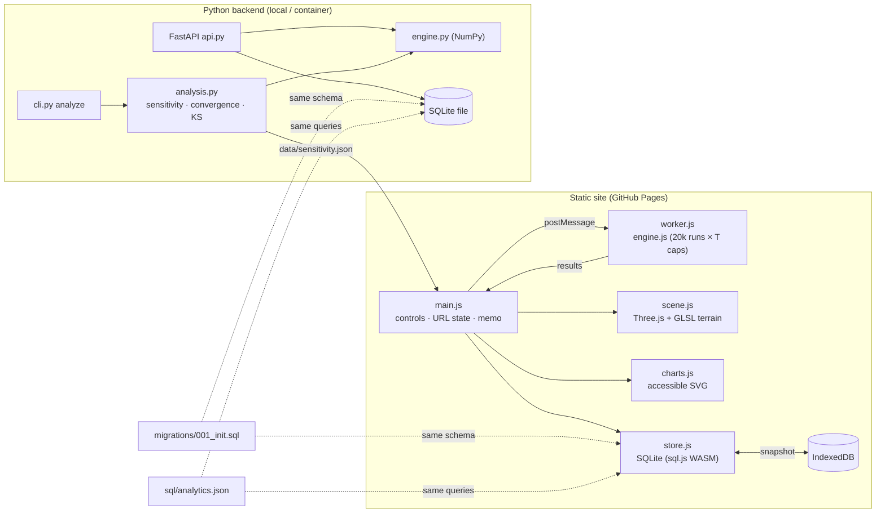

# Architecture

## System at a glance

## What is implemented vs. proposed

| Component | Status | Evidence |
|---|---|---|
| JS engine in a Web Worker | **Implemented** | `app/engine.js`, `app/worker.js`; 14 Node tests |
| WebGL decision terrain (custom GLSL) | **Implemented** | `app/scene.js`; e2e keyboard + picking tests |
| SQLite persistence in the browser | **Implemented** | `app/store.js`; save / load / delete / analytics / read-only console, persisted to IndexedDB (e2e reload test) |
| NumPy engine + FastAPI + SQLite | **Implemented** | `backend/carpool/*`; 19 pytest tests incl. API, migrations, KS test |
| JS ↔ Python parity | **Implemented** | `backend/tests/test_parity.py` (estimates agree within 4 combined SEs) |
| Sensitivity / convergence / seed-stability analysis | **Implemented** | `python -m carpool.cli analyze` → `data/*.json`, rendered on the site |
| CI (GitHub Actions) | **Implemented** | `.github/workflows/ci.yml` runs pytest, Node tests and Playwright e2e |
| Hosted API | **Proposed** | The live site is static; the API runs locally or in a container |
| Auth / multi-user ledger | **Proposed** | Not needed for a single-user analysis tool; see "10× users" |
| Real telemetry ingestion | **Proposed** | SQL in the README shows the queries that would replace the assumed inputs |

## Key decisions (ADR-style)

**1. Compute in the browser, in a Web Worker.** The model is cheap (20,000 runs × 8 caps ≈ 100–300 ms), so a static site can be fully interactive with no server, no cost and no cold starts. A worker keeps sliders and the WebGL scene responsive. *Alternative:* call the FastAPI service per slider move, which adds latency, hosting cost and a failure mode for no accuracy gain.

**2. Two engines (JS and NumPy) with a parity test, not one.** The browser needs JS; analysis, CI and batch sensitivity are better in NumPy/SciPy. Instead of trusting both, `test_parity.py` runs the JS engine under Node and checks agreement within Monte Carlo error. Independent RNGs make this a real test: agreement is not an artifact of shared random numbers.

**3. One schema, one query file.** `migrations/001_init.sql` and `sql/analytics.json` are read by both the browser (sql.js) and the API (sqlite3), and both test suites execute every query. Drift between the two stores fails CI.

**4. SQLite in WASM + IndexedDB snapshots.** Real SQL (joins, aggregates, constraints, cascades) with zero backend. The read-only console runs each statement inside a savepoint that is always rolled back, plus a statement allowlist; this is a defense-in-depth boundary, not a sandbox, so it is documented as such.

**5. Decisions on confidence bounds.** Guardrails use Wilson upper bounds and batch-means lower bounds. This makes the recommendation stable to Monte Carlo noise and turns "close to the line" into an explicit outcome (see evaluation.md).

**6. Vendored libraries.** three.js 0.160.0 and sql.js 1.10.3 (MIT) are committed under `vendor/` so the site works without CDNs, is testable offline, and is version-pinned.

## Workloads, latency and cost
| Path | Work | Measured |
|---|---|---|
| Slider change | 20,000 runs × T caps in the worker (T = 8) | 100–430 ms in headless Chromium (software GL); Node: 99 ms |
| Terrain rebuild | 13 conflict levels × T caps × 1,500 runs | 40–130 ms |
| Python `evaluate` | 20,000 runs × 8 caps (NumPy) | ~50 ms |
| Full analysis (`cli analyze`) | 15 sensitivity evaluations + 20 seeds + 200k-draw KS | ~3 s |
| Page weight | three.js 671 KB + sql.js WASM 656 KB (uncompressed; gzip on Pages) | three.js is skipped entirely on devices without WebGL2 |
| Idle | render-on-demand | 0 long tasks during a 3 s idle window |
| Live site, real GPU (Apple M4, Chrome, Metal) | terrain view, 120 frames | median 16.7 ms, p95 16.8 ms (steady 60 fps); no console errors |

## Failure modes and handling
| Failure | Handling |
|---|---|
| No WebGL2 | Probe before import; never download three.js; show the same data as a table (e2e tested with WebGL disabled) |
| Worker blocked | Falls back to computing on the main thread |
| IndexedDB blocked (private mode) | SQLite stays in memory; the UI says so |
| sql.js fails to load | Ledger shows "Database unavailable"; simulation, charts and memo still work |
| Stale results from fast slider drags | Request tokens: responses from superseded requests are dropped |
| Bad console SQL | Allowlist + savepoint rollback; error shown inline |
| Invalid API input | Pydantic bounds → 422 |

## At 10× the users
The static site scales with the CDN; compute is on each user's device, so 10× users cost nothing extra. What would change is the **shared** use case: a team ledger would need the FastAPI service hosted with Postgres instead of SQLite, authentication (workspace SSO) and row-level ownership on `scenarios`, and a job queue for sensitivity runs (each is ~3 s of CPU). The first bottleneck would be sensitivity analysis on demand; caching by parameter hash (already done in-process with `lru_cache`) moves to a shared cache keyed the same way.

## Model specification
- Setup time per task: `f(s) = 0.7·Gamma(2, 18 s) + 0.3·Gamma(4, 30 s)` (cached resolve vs. cold install), sampled by rejection from an Exponential(70 s) envelope.
- A shared group of m tasks pays one setup × (1 + 0.12·(m−1)) plus 3 s warm attach per extra task.
- Each task pair conflicts with probability p·(1−q); a group conflicts with probability 1 − (1 − p(1−q))^(m(m−1)/2).
- A conflicting group falls back: every task re-pays isolated setup plus a 240 s penalty; 10% of conflicts are hard failures.
- Critical path = the first ⌈T/2⌉ tasks (P90 setup delay is measured on it).
All constants are explicit in `DEFAULTS` / `Params`, and the sensitivity analysis varies each one.
